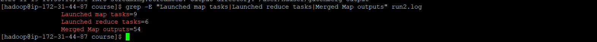
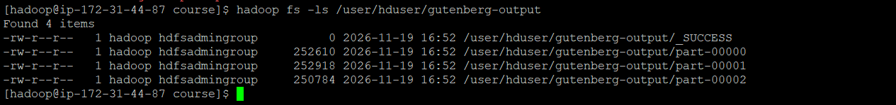
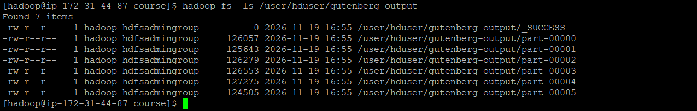
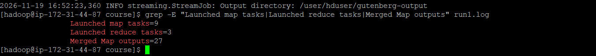

# Exercise 1

Two runs of the same job: first with the default settings, then with `-numReduceTasks 6`.

## Q1. How many files are there?
**6 data files** (`part-00000` … `part-00005`), plus the `_SUCCESS` status file (7 items in total).

## Q2. Did the number of mappers change?
**No.** It stayed at **9** (Launched map tasks = 9 in both runs). The number of mappers depends on the input (one mapper per input split), and the input did not change.

Before: 
After: 

## Q3. Did the number of reducers change?
**Yes**, from **3** (default) to **6**, because we set `-numReduceTasks 6`.

Before: 
After: 

## Q4. Did the number of output files change? Why?
**Yes**, from 3 to 6. Each reducer writes its own output file (`part-0000X`), so 6 reducers = 6 output files.

Before: 
After: 

## Q5. What does the value of 'Merged Map outputs' represent, and how is it calculated?
It is the number of map-output pieces that the reducers fetched and merged in the shuffle phase. Each mapper produces one output partition for each reducer, and each reducer fetches its partition from every mapper. So:

**Merged Map outputs = (number of mappers) × (number of reducers)**
- First run: 9 × 3 = **27**
- Second run: 9 × 6 = **54**

Before: 
After: 
