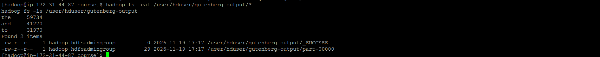

# Exercise 3

**Q1. Is your change in the mapper or in the reducer?**
The reducer. Only the reducer sees the final total of each word, so only it can choose the top 3. It runs with `-numReduceTasks 1` so there is a single global top 3. The mapper is the same as in Exercise 2.

**Q2. Code:** [mapper.py](mapper.py), [reducer.py](reducer.py)

**Q3. Output**

Run with `-numReduceTasks 1`, no external pipes/sort/filters:



```
the  59734
and  41270
to   31970
```
